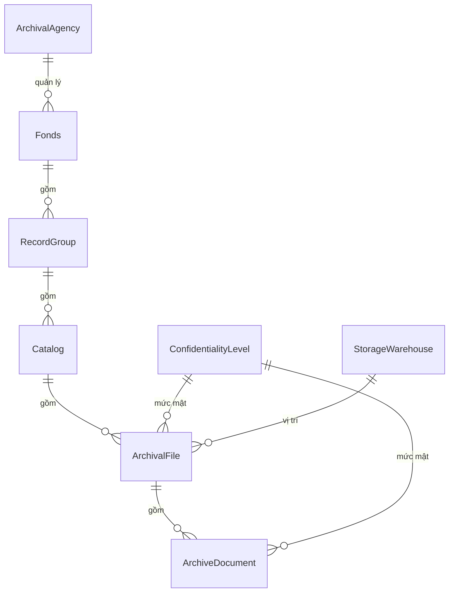
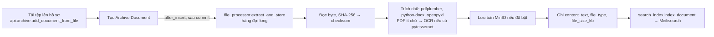
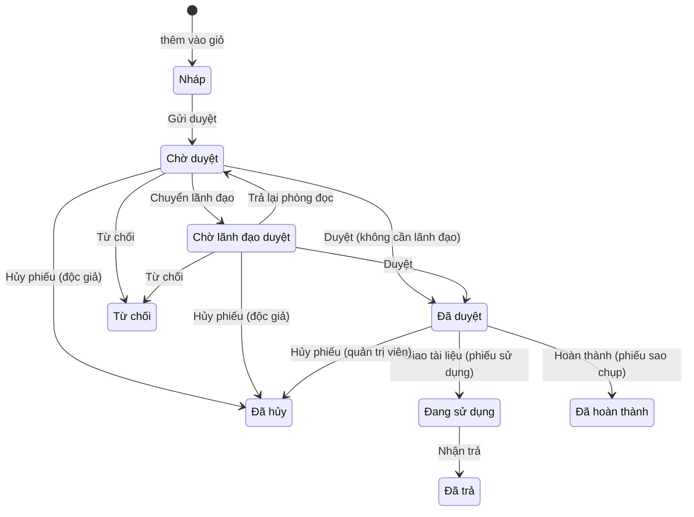

# Tài liệu kỹ thuật – Document Manager

Hệ thống quản lý và khai thác hồ sơ lưu trữ số hóa, xây dựng thành ứng dụng Frappe `document_manager`.

| | |
|---|---|
| Phiên bản mô tả | nhánh `main`, commit `85b9f0e` (15/10/2026) |
| Nền tảng | Frappe Framework v16 (image `frappe/erpnext:v16.26.2`), Python 3, MariaDB 11.8, Redis 7, Meilisearch 1.12 |
| Giao diện | Ứng dụng cán bộ Vue 3 + Vite + Tailwind; trang độc giả Jinja + Alpine.js |
| Đối tượng đọc | Lập trình viên phát triển, bảo trì; kỹ sư vận hành; người đánh giá kỹ thuật khi nghiệm thu |

Tài liệu này mô tả **hệ thống được xây dựng thế nào**: kiến trúc, mã nguồn, dữ liệu, phân quyền, các luồng xử lý, API, công việc
nền, cấu hình, các bước cài đặt và triển khai, bảo mật, kiểm thử và cách mở rộng. Các chủ đề đã có tài liệu riêng chỉ được tóm tắt ở đây kèm liên kết:

| Tài liệu | Nội dung |
|---|---|
| [README.md](../README.md) | Giới thiệu, chức năng, chạy thử nhanh |
| [DEPLOYMENT.md](DEPLOYMENT.md) | Triển khai sản xuất, TLS, cập nhật, xử lý sự cố |
| [DEV_WORKFLOW.md](DEV_WORKFLOW.md) | Quy trình phát triển, hot reload, CI/CD |
| [PHAN_QUYEN_DOC_GIA.md](PHAN_QUYEN_DOC_GIA.md) | Quy tắc phân quyền độc giả và cán bộ (góc nhìn nghiệp vụ) |
| [SAO_LUU_KHOI_PHUC.md](SAO_LUU_KHOI_PHUC.md) | Vận hành sao lưu, kiểm tra toàn vẹn, khôi phục |
| [XML_SCHEMA.md](XML_SCHEMA.md) | Định dạng trao đổi dữ liệu XML |
| [HIEU_NANG.md](HIEU_NANG.md) | Phép đo ở một triệu văn bản |
| [TRACEABILITY.md](TRACEABILITY.md) | Từng yêu cầu của Phụ lục 03 → màn hình, API, kiểm thử |
| [UI_CUSTOMIZATION.md](UI_CUSTOMIZATION.md) | Đổi nhận diện giao diện |

---

## Mục lục

1. [Tổng quan](#1-tổng-quan)
2. [Kiến trúc triển khai](#2-kiến-trúc-triển-khai)
3. [Cấu trúc mã nguồn](#3-cấu-trúc-mã-nguồn)
4. [Các lớp và nguyên tắc thiết kế](#4-các-lớp-và-nguyên-tắc-thiết-kế)
5. [Mô hình dữ liệu](#5-mô-hình-dữ-liệu)
6. [Phân quyền](#6-phân-quyền)
7. [Các luồng xử lý chính](#7-các-luồng-xử-lý-chính)
8. [Giao diện cán bộ (SPA)](#8-giao-diện-cán-bộ-spa)
9. [Giao diện độc giả và trang công khai](#9-giao-diện-độc-giả-và-trang-công-khai)
10. [API](#10-api)
11. [Công việc nền, lịch và sự kiện](#11-công-việc-nền-lịch-và-sự-kiện)
12. [Cấu hình](#12-cấu-hình)
13. [Cài đặt và triển khai](#13-cài-đặt-và-triển-khai)
14. [Bảo mật](#14-bảo-mật)
15. [Hiệu năng](#15-hiệu-năng)
16. [Kiểm thử và CI/CD](#16-kiểm-thử-và-cicd)
17. [Hướng dẫn mở rộng](#17-hướng-dẫn-mở-rộng)
18. [Hạn chế đã biết](#18-hạn-chế-đã-biết)

---

## 1. Tổng quan

Hệ thống phục vụ hai nhóm người dùng qua hai giao diện tách biệt, cùng dùng chung một máy chủ Frappe và một cơ sở dữ liệu:

| Giao diện | Đường dẫn | Người dùng | Công nghệ |
|---|---|---|---|
| **Ứng dụng cán bộ** | `/dashboard/...` | Tài khoản *System User* có ít nhất một nhóm quyền cán bộ | SPA Vue 3, gọi API JSON |
| **Trang độc giả** | `/portal/...`, `/dang-ky`, `/dang-nhap`, ... | Độc giả (*Website User*, vai trò `Reader`) | Trang dựng phía máy chủ (Jinja) + Alpine.js |
| **Trang công khai** | `/gioi-thieu`, `/lanh-dao`, `/co-cau`, `/lien-he`, `/huong-dan` | Khách | Jinja |

Desk của Frappe (`/app`) vẫn tồn tại cho quản trị kỹ thuật (System Manager) nhưng không phải giao diện nghiệp vụ: mọi màn hình
nghiệp vụ nằm trong ứng dụng cán bộ.

Tám phân hệ theo Phụ lục 03:

| # | Phân hệ | Thành phần kỹ thuật chính |
|---|---|---|
| 1 | Khai thác trực tuyến | `www/portal/*`, `api/search.py`, `api/basket.py`, `api/requests.py`, `api/account.py` |
| 2 | Biên mục | `api/archive.py`, `api/crud.py`, `services/archive/*`, `services/file_processor.py` |
| 3 | Danh mục | Màn hình chung (`constants.MASTERS` → `api/meta.py`, `api/crud.py`) |
| 4 | Thống kê, báo cáo | `services/reports/*`, `api/reports.py`, `api/inventory.py` |
| 5 | Xuất, nhập XML | `services/exchange/*`, `api/exchange.py` |
| 6 | Quản lý độc giả | `api/slips.py`, `api/registration.py`, `api/feedback.py`, `services/lifecycle.py`, `services/fonds_access.py` |
| 7 | Bảo quản | `services/preservation/*`, `api/preservation.py` |
| 8 | Quản trị | `api/users.py`, `api/permissions.py`, `api/logs.py`, `api/admin.py`, `services/permission_matrix.py` |

Quy mô mã (ước lượng): 50 DocType, 117 endpoint API, 11 báo cáo, 27 phép kiểm tra toàn vẹn bằng SQL, 23 trang và khoảng 40 thành phần Vue,
22 module test Python (484 test), 191 test vitest, 8 luồng Playwright.

## 2. Kiến trúc triển khai

### 2.1. Sơ đồ

```
                         ┌──────────────────────────────────────────────────────────────┐
Trình duyệt ── HTTP ──▶  │ frontend (nginx :8080)                                       │
                         │   /assets/*  → tệp tĩnh (gồm bundle SPA public/staff)         │
                         │   /socket.io → websocket                                      │
                         │   còn lại    → backend                                        │
                         └───────────────┬──────────────────────────────────────────────┘
                                         ▼
                         backend (gunicorn: Frappe + document_manager)
                            │        │            │                 │
                            ▼        ▼            ▼                 ▼
                         MariaDB   Redis       Meilisearch       Frappe files / MinIO (tùy chọn)
                          11.8   cache/queue   chỉ mục văn bản   tệp gốc / bản đối tượng
                            ▲        │
                            │        ▼
                         queue-long / queue-short (RQ worker)   scheduler (cron của Frappe)
```

### 2.2. Các dịch vụ Docker Compose

Tệp gốc `docker/docker-compose.yml`, chồng thêm `docker-compose.dev.yml` (phát triển) hoặc `docker-compose.prod.yml` (sản xuất).
Production nạp thêm `docker-compose.prod.minio.yml` khi `MINIO_MODE=auto` hoặc `manual` qua `scripts/prod_compose.py`.

| Dịch vụ | Image | Vai trò |
|---|---|---|
| `backend` | `docmanager-custom:<ERPNEXT_VERSION>` | gunicorn chạy Frappe và ứng dụng |
| `frontend` | như trên | nginx: tệp tĩnh, proxy tới backend và websocket; cổng `HTTP_PUBLISH_PORT` |
| `websocket` | như trên | Socket.IO của Frappe |
| `queue-long`, `queue-short` | như trên | Worker RQ cho hàng đợi `long` và `short` |
| `scheduler` | như trên | Chạy `scheduler_events` |
| `configurator` | như trên | Một lần: ghi `common_site_config.json` (DB, Redis) |
| `create-site` | như trên | Một lần: `bench new-site ... --install-app erpnext --install-app document_manager` |
| `db` | `mariadb:11.8` | Cơ sở dữ liệu; cấu hình thêm ở `docker/mariadb/my_custom.cnf` |
| `redis-cache`, `redis-queue` | `redis:7-alpine` | Bộ nhớ đệm; hàng đợi công việc |
| `meilisearch` | `getmeili/meilisearch:v1.12` | Máy tìm kiếm toàn văn |
| `dev-watcher` *(dev)* | như backend | Theo dõi mã nguồn, tự chạy `migrate`/xóa cache (`docker/dev/watcher.py`) |
| `staff-ui` *(dev)* | `node:20-slim` | `vite build --watch` cho giao diện cán bộ |

Volume: `db-data`, `redis-queue-data`, `sites` (site, tệp tải lên, bản sao lưu), `logs`, `meilisearch-data`. Ở chế độ phát triển, thư mục
`apps/document_manager` được gắn thẳng vào các container.

### 2.3. Image

`docker/Dockerfile` có hai tầng:

1. `node:20-slim`: `npm ci`, **chạy vitest**, `vite build` giao diện cán bộ vào `document_manager/public/staff`.
2. `frappe/erpnext:<ERPNEXT_VERSION>`: cài `poppler-utils`, `libmagic1`; chép ứng dụng và bundle đã build; `pip install -e`; liên kết
   `public/` vào `assets/document_manager`.

Máy chủ sản xuất không cần Node. CI build và phát hành image lên GHCR khi push lên `main` hoặc tag `v*`.

### 2.4. Dữ liệu nằm ở đâu

| Dữ liệu | Nơi lưu | Ghi chú |
|---|---|---|
| Siêu dữ liệu, phiếu, người dùng, nhật ký | MariaDB | Nguồn sự thật duy nhất |
| Tệp gốc của văn bản (bản làm việc) | Tệp riêng tư của Frappe: `sites/<site>/private/files` | Liên kết qua `Archive Document.file_attachment` |
| Bản đối tượng bổ sung | MinIO, bucket `documents` (chỉ khi bật) | Trường cũ `gridfs_file_id` giữ để tương thích dữ liệu |
| Nội dung trích xuất | `Archive Document.content_text` (tối đa 65.000 ký tự) và chỉ mục Meilisearch | Không bao giờ gửi nguyên văn cho người dùng |
| Chỉ mục tìm kiếm | Meilisearch, index `archive_documents` | Dựng lại được từ MariaDB (`reindex_all`, `reconcile_index`) |
| Bản sao lưu | Thư mục sao lưu của site: bản kết xuất CSDL `.sql.gz` + kho tệp đặt tên theo SHA-256 | Xem mục 7.8 |
| Hàng đợi, phiên, cache | Redis | Không cần sao lưu |

## 3. Cấu trúc mã nguồn

```
document-manager-project/
├── apps/document_manager/                  ứng dụng Frappe
│   ├── document_manager/                   gói Python
│   │   ├── hooks.py                        tích hợp với Frappe (sự kiện, lịch, quyền, route)
│   │   ├── patches.txt, patches/           patch nâng cấp dữ liệu
│   │   ├── document_manager/               module Frappe "Document Manager"
│   │   │   ├── constants.py                danh sách màn hình, vai trò, chức năng (capability), nhãn
│   │   │   ├── policy.py                   MỘT điểm quyết định quyền (get_access, phạm vi phông, chức năng)
│   │   │   ├── permissions.py              nối policy vào hook của Frappe; trợ giúp cho trang
│   │   │   ├── setup_workflows.py          gieo workflow và thông báo của phiếu
│   │   │   ├── setup/install.py            gieo dữ liệu mặc định (after_install, after_migrate)
│   │   │   ├── api/                        endpoint @frappe.whitelist (lớp mỏng)
│   │   │   ├── services/                   nghiệp vụ
│   │   │   │   ├── archive/                cây lưu trữ: thứ bậc, bộ đếm, khóa
│   │   │   │   ├── exchange/               xuất, nhập XML
│   │   │   │   ├── preservation/           sao lưu, kiểm tra, khôi phục
│   │   │   │   └── reports/                báo cáo
│   │   │   ├── doctype/                    50 DocType (JSON + controller .py)
│   │   │   ├── print_format/               8 mẫu in (phiếu mô tả hồ sơ, mục lục, phiếu, thẻ độc giả)
│   │   │   └── page/document_search/       trang Desk cũ (tìm kiếm)
│   │   ├── www/                            trang dựng phía máy chủ (độc giả, công khai, nơi chứa SPA)
│   │   ├── templates/                      khung Jinja của trang độc giả, mẫu in báo cáo
│   │   ├── public/                         css/js trang độc giả; staff/ = bundle SPA (sinh ra khi build)
│   │   ├── fixtures/role.json              6 vai trò
│   │   └── tests/                          22 module test tích hợp
│   └── frontend/                           mã nguồn SPA cán bộ (Vue 3 + Vite)
│       ├── src/{pages,components,lib}/     trang, thành phần, logic thuần
│       └── tests/                          vitest
├── docker/                                 Dockerfile, compose, cấu hình MariaDB, công cụ dev
├── scripts/
│   ├── e2e/                                accounts.py, e2e_http.py, ui/*.mjs (Playwright)
│   ├── perf/volume_check.py                đo ở quy mô một triệu văn bản
│   └── demo/seed_organization.py           nội dung mẫu cho trang công khai
├── docs/                                   tài liệu
└── .github/workflows/ci.yml                CI/CD
```

Tên module Python đầy đủ bắt đầu bằng `document_manager.document_manager.` (ví dụ `document_manager.document_manager.api.slips`).

## 4. Các lớp và nguyên tắc thiết kế

### 4.1. Đường đi của một yêu cầu

```
Trình duyệt
   │  /api/method/document_manager.document_manager.api.<module>.<hàm>   (SPA, JS của trang độc giả)
   │  /portal/..., /dashboard (trang www)
   ▼
api/<module>.py        kiểm tra đầu vào; cổng quyền: assert_capability / is_staff / assert_feature
   ▼
services/...           nghiệp vụ; mọi truy vấn qua frappe.get_list / get_doc → hook quyền chạy tự động
   ▼
policy.get_access()    ai là ai: admin / staff / reader / guest; phông được xem, được sửa; mức mật; chức năng
   ▼
DocType controller     validate / on_update: ràng buộc thứ bậc, khóa trạng thái, bộ đếm, cấp phép
   ▼
MariaDB  (+ frappe.enqueue(..., enqueue_after_commit=True) cho việc nặng)
```

### 4.2. Nguyên tắc

- **API mỏng, nghiệp vụ trong `services/`.** `api/*.py` chỉ kiểm quyền, làm sạch đầu vào, gọi dịch vụ và định dạng kết quả.
- **Một điểm quyết định quyền.** `policy.get_access(user)` được dùng cho truy vấn SQL (`permission_query_conditions`), kiểm từng bản
  ghi (`has_permission`), tìm kiếm MariaDB và Meilisearch, báo cáo SQL thô, xem/tải tệp và phiếu. Không có nơi nào tự viết lại quy tắc.
- **Dựa vào Frappe thay vì vượt qua nó.** Màn hình chung đọc metadata DocType; quyền trên dữ liệu là DocPerm/Custom DocPerm của Frappe;
  workflow phiếu là Workflow của Frappe. Mã ứng dụng hầu như không dùng `ignore_permissions` ngoài thao tác hệ thống có kiểm soát.
- **Việc nặng chạy nền, sau khi commit.** `frappe.enqueue(..., enqueue_after_commit=True)` với `job_id` để khử trùng lặp; công việc dài có
  tiến độ, hủy được, chạy tiếp được (sao lưu, kiểm tra, khôi phục, xuất/nhập).
- **Gieo dữ liệu idempotent.** `setup/install.seed_all` chạy ở mọi `migrate`, chỉ tạo phần còn thiếu, không ghi đè dữ liệu của site.
- **Nhật ký ở một chỗ.** `services/audit.py` ghi mọi thay đổi trên DocType nghiệp vụ, đăng nhập/đăng xuất, xem/tải tài liệu, thao tác
  quản trị; không chép giá trị nhạy cảm vào nhật ký.
- **Giao diện tiếng Việt, mã tiếng Anh.** Tên DocType, trường, hàm bằng tiếng Anh; nhãn, thông báo, giá trị chọn (trạng thái) bằng tiếng Việt.

## 5. Mô hình dữ liệu

### 5.1. Cây lưu trữ năm cấp



| DocType | Tên tự sinh | Trường chính | Ghi chú |
|---|---|---|---|
| **Fonds** (Phông) | `FONDS-####` | `fonds_name`, `fonds_code`, `archival_agency`, `status`, `access_mode`, `allow_copy`, `total_files` | `status`: Đang xử lý / Đã hoàn thành / Đã đóng. `access_mode`: Theo cấp phép (mặc định) / Công khai / Nội bộ |
| **Record Group** (Khối) | `RG-####` | `group_title`, `group_code`, `fonds` | |
| **Catalog** (Mục lục) | `CAT-####` | `catalog_title`, `catalog_number`, `record_group`, `fonds` | |
| **Archival File** (Hồ sơ) | `AF-#####` | `file_number`, `file_title`, `catalog`, `status`, `start_date`, `end_date`, `confidentiality_level`*, `retention_years`*, `disposal_status`*, vị trí kho | `status`: Nháp / Đang xử lý / Đã hoàn thành / Đã đóng. `disposal_status`: Bình thường / Cảnh báo tiêu hủy / Đã tiêu hủy |
| **Archive Document** (Văn bản) | `DOC-######` | `document_number`, `document_title`, `document_date`, `author`, `archival_file`, `confidentiality_level`*, `file_attachment`, `file_type`, `checksum`, `gridfs_file_id`, `storage_tier`, `search_index_status`, `content_text` | `search_index_status`: Chưa index / Đang xử lý / Đã index / Lỗi |

\* Trường *permlevel 1* (trường nhạy cảm), xem mục 6.6.

Quy tắc của cây (`services/archive/hierarchy.py`, `counters.py`, `locks.py`):

- **Phi chuẩn hóa có chủ đích.** Mỗi cấp dưới lưu lại mọi cấp trên (`Archive Document` có `archival_file`, `catalog`, `record_group`,
  `fonds`) để lọc và phân quyền theo phông bằng một điều kiện chỉ mục, không cần JOIN. Controller tự suy các trường này từ cấp cha.
- **Chuyển cấp cha** (ví dụ hồ sơ sang mục lục khác) cập nhật các cấp dưới bằng công việc nền; chuyển sang phông khác cần quyền sửa cả hai phông.
- **Không xóa cha còn con**; xóa được thì bộ đếm của cấp trên được tính lại.
- **Bộ đếm** (`total_files` của phông, `total_documents`, `total_pages` của hồ sơ) được duy trì khi thêm/xóa/chuyển, và có phép kiểm tra
  toàn vẹn kèm nút sửa (`fix_counters`).
- **Khóa theo trạng thái**: phông hoặc hồ sơ *Đã đóng*, hồ sơ *Đã tiêu hủy* không sửa, thêm, xóa được nội dung, trừ người có chức năng
  `archive.edit_closed`. *Đã hoàn thành* không bị khóa (là trạng thái công bố cho độc giả).
- **Công bố cho độc giả**: hồ sơ không phải *Nháp* và không *Đã tiêu hủy*; văn bản theo hồ sơ chứa nó.
- **Chỉ mục** trên các cột lọc nhiều (`fonds`, `catalog`, `archival_file`, `status`, `confidentiality_level`, `document_date`, ...) và chỉ mục
  kép `(catalog, file_number)`, `(archival_file, document_number)` (patch `add_volume_indexes`).

### 5.2. Danh mục

`Archival Agency`, `Document Type Category`, `Document Group`, `Storage Warehouse` (cây: kho → phòng → giá → hộp), `Confidentiality Level`
(`priority` 1–4, `requires_leader_approval`, `allow_copy`), `Classification Scheme` (cây), `Dictionary Type` + `Quick Entry Dictionary`
(từ điển nhập nhanh một hoặc nhiều cấp, dùng để gợi ý khi nhập, ví dụ "Cơ quan ban hành"). Các cây dùng nested set của Frappe (`lft`, `rgt`).

Mức độ mật gieo sẵn: Thường (1), Mật (2), Tối mật (3), Tuyệt mật (4). So sánh quyền dùng `priority`, không dùng tên.

### 5.3. Độc giả, phiếu và góp ý

| DocType | Loại | Vai trò |
|---|---|---|
| `Reader` (`RDR-####`) | thường | Hồ sơ độc giả; `user` (tài khoản, có thể trống), `reader_group`, `max_confidentiality_priority` (0 = theo nhóm), `fonds_grants` (cấp phép riêng) |
| `Reader Group` | thường | Mức mật tối đa, 6 cờ tính năng (`can_search`, `can_preview`, `can_download`, `can_request_usage`, `can_request_copy`, `can_feedback`), `approval_mode`, hạn mức, `fonds_scopes` (cấp phép cho cả nhóm), `is_default` |
| `Reader Group Scope` | bảng con | Một cấp phép phông: `fonds`, `valid_from`, `valid_until`, `note`, `granted_by`, `granted_on`; dùng cho cả nhóm và từng độc giả |
| `Reader Registration` (`REG-YYYY-#####`) | thường | Đăng ký trực tuyến chờ duyệt: Mới / Đã duyệt / Từ chối |
| `Usage Request` (`UR-YYYY-#####`) | submittable + workflow | Phiếu yêu cầu sử dụng; `items` (`Usage Request Item`), `due_date`, `is_overdue`, `renewal_count`, `requires_leader` |
| `Copy Request` (`CR-YYYY-#####`) | submittable + workflow | Phiếu sao chụp; `items` (`Copy Request Item`: `copy_count`, `copy_form`, `page_range`) |
| `Reader Feedback` (`FB-YYYY-####`) | workflow | Góp ý: Mới / Đã xem / Đã phản hồi |
| `Request Template` | thường | Mẫu phiếu, mẫu đăng ký: mục đích, trường thêm |
| `Reader Settings` | single | Hạn mức chung, gia hạn, nhắc hạn, chặn khi quá hạn, cho tự đăng ký |

Mỗi dòng phiếu trỏ tới **một** hồ sơ hoặc **một** văn bản và lưu lại tiêu đề lúc lập phiếu, để phiếu cũ vẫn đọc được khi độc giả mất quyền.

### 5.4. Cán bộ và phân quyền

| DocType | Vai trò |
|---|---|
| `Staff Role Profile` (khóa = `role`) | Hồ sơ của một nhóm quyền (một Frappe Role): nhãn, loại (Quản trị / Tác nghiệp), `is_builtin`, `is_admin`, `capabilities` (`Staff Role Capability`) |
| `Staff Access` (khóa = `user`) | Phạm vi của một cán bộ: `read_scope` + `read_fonds`, `write_scope` + `write_fonds`, `max_confidentiality_priority` |
| `Staff Group` | Nhóm cán bộ: `roles` cấp cho mọi thành viên, `members`, tùy chọn `apply_scope` với cùng các trường phạm vi |
| `Staff Access Fonds` | Bảng con: một phông của phạm vi |

Quyền trên dữ liệu của từng nhóm quyền **không** nằm trong bảng của ứng dụng mà là `Custom DocPerm` của Frappe (mục 6.3).

### 5.5. Bảo quản, trao đổi, nhật ký, đơn vị

| DocType | Vai trò |
|---|---|
| `Backup Batch` (`BK-YYYYMMDD-###`), `Backup Batch Item` | Một đợt sao lưu (CSDL, tệp hoặc cả hai) và danh sách tệp của nó |
| `Integrity Check` (`IC-...`), `Integrity Check Item` | Một đợt kiểm tra và các phát hiện |
| `Restore Batch` (`RS-...`), `Restore Batch Item` | Một đợt khôi phục tệp |
| `Data Exchange Job` (`XJ-YYYY-#####`), `Data Exchange Row` | Một lượt xuất hoặc nhập XML và nhật ký từng dòng |
| `Inventory Check` (`KK-YYYY-###`), `Inventory Check Item` | Kỳ tổng kiểm kê phông: số liệu hệ thống và số đếm thực tế |
| `Business Activity Log` (`LOG-######`) | Nhật ký hệ thống; chỉ mục trên loại, đối tượng, người dùng, thời điểm |
| `Organization Info` (single) + `Organization Leader`, `Organization Unit` (cây) | Thông tin đơn vị cho trang công khai và đầu đề bản in |
| `Document Manager Settings` (single) | Sao lưu tự động, giữ nhật ký, chính sách mật khẩu, khóa đăng nhập |

## 6. Phân quyền

Quy tắc nghiệp vụ đầy đủ: [PHAN_QUYEN_DOC_GIA.md](PHAN_QUYEN_DOC_GIA.md). Mục này mô tả cách cài đặt.

### 6.1. `policy.get_access(user)`

Trả một đối tượng, nhớ trong `frappe.local.dm_policy_memo` trong phạm vi một request (xóa bằng `policy.clear_cache()` khi nhóm quyền,
phạm vi, cấp phép hoặc chế độ phông thay đổi):

| Trường | Quản trị viên | Cán bộ | Độc giả | Khách |
|---|---|---|---|---|
| `kind` | `admin` | `staff` | `reader` | `guest` |
| `read_fonds` | `None` (mọi phông) | `None` hoặc danh sách | phông công khai ∪ cấp phép còn hiệu lực, trừ phông nội bộ | `[]` |
| `write_fonds` | `None` | `None` hoặc danh sách | `[]` | `[]` |
| `max_priority` | không giới hạn | theo phạm vi (mặc định không giới hạn) | theo nhóm, ghi đè cá nhân | — |
| chức năng | mọi chức năng | hợp chức năng của các nhóm quyền | 6 cờ tính năng của nhóm độc giả | — |

Quản trị viên = vai trò `Document Admin`, `System Manager` hoặc tài khoản `Administrator`; phạm vi của họ không bao giờ bị thu hẹp.

Các hàm thường dùng: `is_staff`, `is_admin`, `capabilities_of`, `has_capability`, `assert_capability`, `users_with_capability`,
`staff_scope`, `fonds_sql`, `assert_fonds_writable`, `assert_all_fonds`, `get_reader_scope` (lớp tương thích cho độc giả),
`reader_scope_of(profile)` (phạm vi tính từ hồ sơ độc giả, không từ tài khoản đăng nhập), `assert_feature`, `get_limits`.

### 6.2. Chức năng (capability)

Những quyền không gắn với một loại dữ liệu được khai báo trong `constants.CAPABILITIES` (18 mã) và kiểm bằng `assert_capability(code)`:

| Nhóm | Mã |
|---|---|
| Độc giả và khai thác | `slips.view`, `slips.receive`, `slips.leader_approve`, `feedback.handle`, `readers.registrations`, `readers.grant_fonds` |
| Biên mục | `inventory.manage`, `inventory.reopen`, `archive.edit_closed` |
| Trao đổi dữ liệu | `exchange.export`, `exchange.import` |
| Bảo quản | `preservation.backup`, `preservation.check`, `preservation.restore`, `preservation.db_restore` |
| Quản trị | `logs.view`, `logs.purge`, `monitor.view` |

`users.manage` (người dùng, nhóm quyền, phạm vi) chỉ quản trị viên có và không giao được. Chức năng mặc định của năm nhóm có sẵn nằm ở
`constants.BUILTIN_CAPABILITIES`. Workflow phiếu và người nhận thông báo được dựng lại theo chức năng (`setup_workflows._roles_with`) mỗi khi
chức năng phiếu của một nhóm thay đổi.

### 6.3. Quyền trên dữ liệu: `services/permission_matrix.py`

- Mỗi ô của ma trận (nhóm quyền × DocType) là một dòng `Custom DocPerm` (permlevel 0) cộng một dòng permlevel 1 cho trường nhạy cảm.
  Khi một DocType đã có Custom DocPerm, Frappe bỏ qua quyền chuẩn trong JSON, nên lần ghi đầu chép toàn bộ quyền chuẩn sang
  (`setup_custom_perms`) rồi mới sửa.
- Có quyền bất kỳ thì tự có *Xem*; bỏ *Xem* thì dòng bị làm rỗng. Cờ mà DocType không hỗ trợ (`import`, `submit`, ...) bị xóa (`_sanitise`).
- Sau khi ghi: `clear_permissions_cache`, `frappe.clear_cache(doctype=...)` và `frappe.local.role_permissions = {}`. Nhiều ô được ghi
  trong `permission_matrix.batch()` để chỉ xóa cache một lần.
- "Khôi phục mặc định" của nhóm có sẵn áp lại quyền chuẩn trong JSON cho riêng vai trò đó.

### 6.4. Hook của Frappe: `permissions.py`

`hooks.permission_query_conditions` và `hooks.has_permission` trỏ tới các hàm trong `permissions.py` cho Fonds, Record Group, Catalog,
Archival File, Archive Document, Usage Request, Copy Request, Reader Feedback và Reader.

- **Truy vấn danh sách** (`_archive_query`): độc giả nhận điều kiện phông, mức mật và trạng thái công bố; cán bộ có phạm vi nhận điều kiện
  `fonds IN (...)` theo phông được xem và mức mật; quản trị viên và cán bộ không có phạm vi không nhận điều kiện nào.
- **Kiểm từng bản ghi** (`_archive_permission`): với `read`/`print`/`export`/... dùng phạm vi xem; với `write`/`create`/`delete`/`submit`
  dùng phạm vi sửa (`fonds_of(doc)` lấy phông của bản ghi ở mọi cấp). Hàm trả `False` là từ chối.
- Phiếu, góp ý, độc giả: độc giả chỉ thấy bản ghi của chính mình; cán bộ theo DocPerm.

### 6.5. Phạm vi phông

- **Cán bộ** (`policy.staff_scope`): hợp phạm vi riêng (`Staff Access`) và phạm vi của các `Staff Group` có `apply_scope`. Không có cả hai:
  mọi phông. Chỉ thuộc nhóm có phạm vi: chỉ phông của nhóm.
- **Độc giả** (`services/fonds_access.reader_fonds`): phông *Công khai* ∪ cấp phép của nhóm ∪ cấp phép riêng, chỉ tính dòng trong khoảng
  `valid_from`–`valid_until`, trừ phông *Nội bộ*. Một phông được cấp nhiều lần thì cấp phép dài nhất thắng (`fonds_until`).
- Cấp, sửa, thu hồi cấp phép cần `readers.grant_fonds`; `validate_grants` chặn trùng phông, phông nội bộ, ngày sai và đóng dấu người cấp.

### 6.6. Trường nhạy cảm và khóa

- `confidentiality_level` (hồ sơ, văn bản), `retention_years`, `disposal_status` có `permlevel: 1`. Người không có quyền ghi level 1 vẫn
  xem được nhưng Frappe tự trả giá trị cũ khi lưu.
- `services/archive/locks.py`: `lock_reason(doc)`, `assert_unlocked(doc, action)` (gọi trong `validate`/`on_trash` của các DocType cây),
  `assert_move_allowed(doc)`. API `crud.get`/`save` trả thêm `_rights = {write, delete, locked}` để giao diện khóa form và hiện dải thông báo.

### 6.7. Phiếu

`services/request_base.py` kiểm mỗi dòng phiếu theo `reader_scope_of(phiếu.reader)` (quyền của độc giả của phiếu, kể cả khi cán bộ lập hộ)
ở lúc thêm vào giỏ, gửi, duyệt (`_on_approved`) và giao (`_on_issued`). Phiếu sao chụp còn kiểm `allow_copy` của phông và của mức mật.

## 7. Các luồng xử lý chính

### 7.1. Tải tệp và xử lý nền



- Kiểm tra trước khi nhận tệp: phần mở rộng thuộc `constants.UPLOAD_EXTENSIONS` (pdf, docx, xlsx, doc, xls, jpg, jpeg, png, tif, tiff), kích thước
  ≤ `UPLOAD_MAX_MB` (100 MB), quyền sửa phông của hồ sơ, hồ sơ không bị khóa.
- Mỗi bước cập nhật `search_index_status` (Đang xử lý → Đã index hoặc Lỗi). Công việc có `job_id` theo tên văn bản, nên `after_insert` và
  `on_update` của cùng một lần lưu chỉ tạo một job.
- Sửa siêu dữ liệu không đổi tệp chỉ lập chỉ mục lại; sửa hồ sơ (tiêu đề, mức mật, trạng thái) lập chỉ mục lại các văn bản của nó.
- Job hằng ngày `search_index.reconcile_index` đối chiếu MariaDB với Meilisearch và lập chỉ mục bù.

### 7.2. Tìm kiếm

- **Đường chính**: Meilisearch (`search_index.search`). Bộ lọc được dựng từ `get_access`: `is_published = true` cho độc giả,
  `confidentiality_priority <= n`, `fonds IN [...]`. Thuộc tính tìm: tiêu đề, nội dung, số, tác giả, tên phông, tên hồ sơ.
- **Dự phòng**: khi Meilisearch không trả lời, `search_service._search_documents_db` tìm bằng `frappe.get_list` (hook quyền tự áp) trong
  `queries.bounded_scan()`: mọi câu lệnh quá 8 giây bị MariaDB cắt và người dùng nhận thông báo thu hẹp tìm kiếm. Tổng số kết quả có trần
  10.000 (`capped_count`); trang chưa đầy thì chính nó là tổng.
- Tìm hồ sơ và tìm nâng cao theo trường (tiêu đề, số, tác giả, ngày, phông, ...) luôn đi qua MariaDB.
- Không bao giờ trả `content_text`: kết quả chỉ có đoạn trích ngắn.

### 7.3. Xem trước và tải tệp

`api/file_access.py`: `get_preview` (siêu dữ liệu, không lộ id đối tượng hay đường dẫn riêng), `preview_file` (PDF/ảnh hiển thị trong trình duyệt),
`download_file`. Mỗi lời gọi kiểm tính năng (`can_preview` hoặc `can_download`) và quyền đọc văn bản qua `doc.check_permission("read")`, đọc byte
từ MinIO trước nếu đã bật rồi tới tệp trên đĩa, ghi `last_accessed` và nhật ký "Xem"/"Tải xuống".

### 7.4. Phiếu sử dụng và phiếu sao chụp



- **Giỏ** (`services/basket.py`): phiếu *Nháp* trên máy chủ, một phiếu mỗi loại mỗi độc giả; thêm/bớt mục bằng `api/basket.py`.
- **Gửi**: kiểm tính năng, hạn mức (`lifecycle.check_quota`: số phiếu/ngày, số mục/phiếu, số phiếu đang mở, chặn khi có phiếu quá hạn) và
  quyền của độc giả trên từng mục. `requires_leader` được tính theo `approval_mode` của nhóm độc giả và cờ `requires_leader_approval` của mức mật.
- **Duyệt**: cán bộ phòng đọc quyết định **từng mục** (`api/slips.decide_items`: đồng ý hoặc từ chối có lý do), rồi thực hiện hành động
  workflow qua `api/requests.apply_action`. Mục hết quyền (cấp phép hết hạn hoặc bị thu hồi) chặn việc duyệt.
- **Giao, trả, gia hạn**: `due_date` = ngày giao + số ngày giữ, không vượt ngày hết hạn cấp phép (`lifecycle.access_end`); gia hạn tối đa
  `max_renewals` lần và cũng dừng ở ngày đó.
- **Quá hạn** là cờ `is_overdue`, không phải trạng thái: job hằng ngày `overdue.mark_overdue_and_remind` đặt cờ và nhắc độc giả.
- **Thông báo**: `services/notify.py` tạo Notification Log cho độc giả khi phiếu đổi trạng thái hoặc góp ý được trả lời; thông báo cho cán bộ
  gửi tới người có chức năng tương ứng (`notify_capability`).

### 7.5. Đăng ký độc giả

`api/registration.register_reader` (khách, giới hạn 10 lần/giờ mỗi IP) tạo `Reader Registration`; không thông báo nào cho biết email đã tồn tại.
Cán bộ có `readers.registrations` duyệt → tạo `Reader` và tài khoản *Website User*, trả một **liên kết đặt mật khẩu dùng một lần** (hiệu lực 72 giờ,
`System Settings.reset_password_link_expiry_duration`) để cán bộ chuyển cho độc giả; không phụ thuộc email. `request_password_reset` (khách, 5 lần/giờ).

### 7.6. Báo cáo

- `services/reports/base.py`: registry `REPORTS`, khai báo bộ lọc, cột, phân trang; `Where` dựng điều kiện SQL có tham số, gồm `fonds_scope(column)` và
  `level_scope(column)` để báo cáo SQL thô vẫn theo phạm vi của người xem.
- 11 báo cáo: `phong`, `muc-luc`, `ho-so`, `van-ban`, `thong-ke-phong`, `thong-ke-loai-hinh-kho`, `tong-kiem-ke` (`reports/archive.py`); `doc-gia`,
  `thong-ke-phieu`, `phieu-qua-han`, `tai-lieu-duoc-khai-thac` (`reports/readers.py`).
- Người xem được một báo cáo khi là cán bộ và đọc được mọi DocType báo cáo cần (`reports.can_run`).
- `reports/output.py`: CSV, XLSX (toàn bộ kết quả), bản in HTML/PDF có đầu đề đơn vị (`templates/reports/report_print.html`).

### 7.7. Xuất, nhập XML

- `exchange/schema.py`: các cấp trao đổi (Phông › Khối › Mục lục › Hồ sơ › Văn bản), trường của từng cấp, trường định danh; **XSD sinh từ chính
  danh sách đó** (`build_xsd`), dùng cho cả tệp tải về và kiểm tra khi nhập.
- `exchange/xmlio.py`: chỉ nhận UTF-8, không DTD/ENTITY, parser `lxml` với `resolve_entities=False`, `no_network=True`, `load_dtd=False`,
  `huge_tree=False`; giới hạn kích thước; kiểm XSD và báo lỗi kèm số dòng; ghi tệp xuất theo luồng.
- `exchange/exporter.py`: xuất theo bộ lọc, chọn trường theo cấp, kèm cấp trên (chỉ trường khóa) và tùy chọn mọi cấp dưới.
- `exchange/importer.py`: duyệt từ trên xuống, thêm hoặc cập nhật theo trường định danh (nhập lại cùng tệp không tạo bản ghi mới), **chạy với quyền của
  người yêu cầu**, có chế độ chạy thử (không ghi gì), ghi kết quả từng dòng vào `Data Exchange Row`.
- `exchange/jobs.py`: `Data Exchange Job` chạy ở hàng đợi `long`, có tiến độ, hủy, tải tệp kết quả. Cần `exchange.export` / `exchange.import`.

Chi tiết định dạng: [XML_SCHEMA.md](XML_SCHEMA.md).

### 7.8. Bảo quản

- **Sao lưu** (`preservation/backup.py`): CSDL bằng cơ chế backup của Frappe (`.sql.gz`, có mã băm); tệp được chép vào **kho theo nội dung**
  (`filestore.py`: một blob cho mỗi nội dung, đặt tên bằng SHA-256, dùng chung giữa các đợt, nên lần sau chỉ chép tệp mới). Tệp nguồn có mã băm khác
  với mã lúc tải lên bị báo và **không** được chép, để tệp hỏng không thay bản tốt. Chạy theo trang, có `cursor` để chạy tiếp. Giữ theo
  `backup_retention_days` nhưng không bao giờ dưới `backup_keep_min` đợt thành công. Lịch: job hằng ngày `backup.run_scheduled` đọc tần suất trong thiết lập.
- **Kiểm tra toàn vẹn** (`preservation/integrity.py`): 27 phép SQL (`DB_CHECKS`: mồ côi, sai thứ bậc, mức mật hỏng, bộ đếm, ngày, trùng số, thiếu mã băm,
  lỗi chỉ mục; `META_CHECKS`: thiếu siêu dữ liệu bắt buộc) và kiểm từng tệp (tồn tại trên đĩa, trong MinIO nếu bật, khớp SHA-256, có bản sao lưu khôi phục được).
  Phát hiện ghi vào `Integrity Check Item`, có trạng thái xử lý. Lịch: Chủ nhật 2 giờ sáng.
- **Khôi phục** (`preservation/restore.py`): đợt khôi phục tệp từ bản sao lưu, thường tạo từ kết quả kiểm tra; khôi phục CSDL **mặc định chỉ hiện hướng dẫn**
  đã kiểm tra, chỉ tự chạy khi site đặt `dm_allow_db_restore = 1` và có mật khẩu root.
- `preservation/runner.py`: phần chung của ba loại job (xếp hàng, hủy, chạy tiếp, ghi phát hiện, kết thúc).
- Sao lưu CSDL, tải bản sao lưu, dọn bản cũ, khôi phục CSDL và kiểm tra toàn bộ kho cần phạm vi **mọi phông** (`assert_all_fonds`).

Vận hành: [SAO_LUU_KHOI_PHUC.md](SAO_LUU_KHOI_PHUC.md).

### 7.9. Nhật ký

`services/audit.py`: `audit_doc_event` gắn vào `after_insert`, `on_update`, `on_update_after_submit`, `on_trash` của 29 DocType nghiệp vụ (danh sách
`_AUDITED` trong `hooks.py`); `on_login`/`on_logout`; `log_activity` cho xem, tải, tìm, thao tác quản trị. Chỉ ghi trường dạng trạng thái, không chép giá trị
nhạy cảm; không bao giờ làm hỏng thao tác gốc. Tắt được bằng `enable_activity_log`. Không ai sửa hay xóa lẻ dòng nhật ký: dọn qua `api/logs.purge` (chỉ dòng
cũ hơn 7 ngày, phải nhập lại số dòng, và việc dọn cũng được ghi), cộng job hằng ngày `cleanup_old_logs` theo `log_retention_days`.

## 8. Giao diện cán bộ (SPA)

### 8.1. Build và phục vụ

- Mã nguồn `apps/document_manager/frontend`; Vite build vào `document_manager/public/staff` với `base = /assets/document_manager/staff/` và manifest.
- `www/dashboard.py` là trang chứa: chặn người không phải cán bộ (độc giả về `/portal`, khách về trang đăng nhập), nhúng **dữ liệu khởi động** (người dùng,
  thanh bên, CSRF token) dưới dạng JSON, và chèn tệp JS/CSS có hash đọc từ manifest.
- `hooks.website_route_rules` đưa mọi `/dashboard/<đường dẫn>` về cùng trang; Vue Router dùng `createWebHistory("/dashboard")`.
- Phát triển: dịch vụ `staff-ui` chạy `vite build --watch` (thăm dò tệp vì bind mount Windows không phát sự kiện).

### 8.2. Tổ chức mã

| Thư mục | Nội dung |
|---|---|
| `src/pages/` | 23 trang: `DashboardHome`, `ArchiveBrowser` (cây biên mục), `FilePage`, `DocumentPage`, `SearchPage`, `SlipsPage`/`SlipPage`, `RegistrationsPage`, `FeedbackPage`, `ReportsHub`/`ReportPage`, `ExchangePage`, `PreservationPage`, `UsersPage`, `RolesPage`, `GroupsPage`, `LogsPage`, `MonitorPage`, `SettingsPage`, `MasterPage`/`MasterList`/`MasterTree` (màn hình chung) |
| `src/components/` | Khung (`AppShell`, `SidebarNav`, `CommandPalette` Ctrl+K), dữ liệu (`DataTable`, `FilterForm`, `PaginationBar`), biểu mẫu (`FormRenderer`, `FieldInput`, `LinkSelect`, `TableInput`, `FondsPicker`), `RecordDrawer`, `DocumentPreview`, `FileUploader`, hộp thoại, `BarChart` |
| `src/lib/` | Logic thuần có test: `api.js` (client), `boot.js`, `doctype.js`, `admin.js`, `slips.js`, `reports.js`, `exchange.js`, `preservation.js`, `upload.js`, `format.js`, ... |

### 8.3. Quy ước

- `lib/api.js` gọi `/api/method/...` với header `X-Frappe-CSRF-Token`, JSON, và chuyển `_server_messages`/`exc_type` thành `ApiError` dễ đọc.
- **Màn hình chung**: `constants.py` khai báo DocType được mở (`MASTERS`, `ARCHIVE_SCREENS`, `READER_SCREENS`, `SETTINGS_SCREENS`, `INVENTORY_SCREENS`,
  `ADMIN_SCREENS`) cùng slug, nhãn, cột, trường ẩn, gợi ý từ điển. `api/meta.get_doctype_ui` → `services/ui.describe` biến metadata thành mô tả danh sách,
  biểu mẫu (bố cục, permlevel, trường chỉ đọc) và cây, đã cắt theo quyền của người dùng. `api/crud.py` làm list/get/save/delete/link_search/tree_children,
  luôn qua quyền của Frappe.
- Thanh bên và nút hành động hiện theo dữ liệu khởi động và `_rights` của bản ghi; ẩn nút chỉ là tiện lợi, máy chủ luôn kiểm lại.
- Danh sách bỏ qua phản hồi cũ khi bộ lọc đổi; công việc nền được theo dõi bằng cách hỏi lại `get_job` định kỳ (không dùng realtime).

## 9. Giao diện độc giả và trang công khai

| Đường dẫn | Tệp | Nội dung |
|---|---|---|
| `/gioi-thieu`, `/lanh-dao`, `/co-cau`, `/lien-he`, `/huong-dan` | `www/don-vi.html` + `services/public_site.py` | Trang công khai (trang chủ của site) |
| `/dang-ky`, `/dang-nhap`, `/quen-mat-khau`, `/dat-mat-khau` | `www/*.html` | Đăng ký, đăng nhập, mật khẩu |
| `/portal` | `www/portal/index.html` | Tìm hồ sơ, văn bản (cơ bản, nâng cao), "Thêm vào phiếu" |
| `/portal/ho-so/<name>`, `/portal/van-ban/<name>` | `ho-so.html`, `van-ban.html` | Chi tiết, xem trước, tải |
| `/portal/phieu`, `/portal/sao-chep` (+ `/<name>`) | `phieu.html`, `sao-chep.html` | Phiếu của độc giả |
| `/portal/gop-y`, `/portal/thong-bao`, `/portal/tai-khoan` | | Góp ý, thông báo, tài khoản (gồm phông được khai thác) |

- Mọi trang gọi `www/_reader_ui.page_context(...)` (thông tin đơn vị, menu, người đăng nhập, số mục trong giỏ, số thông báo) và `require_reader()` nếu cần phiên.
- Khung chung `templates/reader/base.html`, macro, biểu tượng; tài nguyên `public/css/dm-reader.css`, `public/js/dm-reader.js`, `public/js/vendor/alpine.min.js`.
- Jinja của Frappe **không tự thoát HTML**: mọi mẫu trang độc giả bọc ``.
- Địa chỉ cũ (`/readers`, `/usage_requests`, `/reports`, ...) chuyển hướng 301 (`hooks.website_redirects`) hoặc qua `www/_legacy.py`.

## 10. API

### 10.1. Quy ước

- Địa chỉ: `/api/method/document_manager.document_manager.api.<module>.<hàm>`. Đọc bằng GET, ghi bằng POST (`methods=["POST"]` ở các hàm ghi).
- Xác thực bằng phiên Frappe (cookie) và CSRF token; không có API công khai cho bên thứ ba ngoài ba hàm cho khách của `registration`.
- Lỗi: `frappe.throw` với `PermissionError` (403), `DoesNotExistError` (404), `ValidationError` (417), thông báo tiếng Việt.
- Sửa đồng thời: các hàm lưu (`crud.save`, `permissions.save_group`, ...) nhận lại `modified` đã đọc và báo lỗi thay vì ghi đè khi bản ghi
  vừa bị người khác sửa.

### 10.2. Danh sách module

| Module | Hàm | Cổng quyền |
|---|---|---|
| `account` | `get_account`, `update_profile`, `change_password`, `get_notifications`, `get_unread_count`, `mark_notifications_read` | độc giả đăng nhập; đổi mật khẩu 10 lần/15 phút |
| `admin` | `get_service_health`, `monitor` | `monitor.view` |
| `archive` | `get_tree`, `get_file_overview`, `get_document_overview`, `add_document_from_file`, `attach_file`, `reindex_document`, `download_print_pdf` | cán bộ + quyền Frappe + phạm vi phông |
| `basket` | `get_basket`, `add_to_basket`, `remove_from_basket`, `discard_draft` | độc giả có tính năng lập phiếu |
| `boot` | `get_staff_boot` | cán bộ |
| `crud` | `get_list`, `get`, `save`, `delete`, `link_search`, `tree_children` | DocType đã đăng ký + quyền Frappe |
| `dashboard` | `get_workspace_summary` | theo quyền Frappe |
| `exchange` | `capabilities`, `preview_export`, `start_export`, `analyze_import`, `start_import`, `get_job`, `list_jobs`, `cancel_job`, `delete_job`, `download`, `download_schema` | `exchange.export` / `exchange.import` |
| `feedback` | `list_feedback`, `get_feedback` | `feedback.handle` |
| `file_access` | `get_preview`, `preview_file`, `download_file`, `log_document_access` | tính năng `can_preview`/`can_download` + quyền đọc văn bản |
| `fonds_access` | `who_may_use` | cán bộ |
| `inventory` | `populate`, `complete`, `reopen` | `inventory.manage` / `inventory.reopen` |
| `logs` | `filter_options`, `list_logs`, `get_log`, `download_logs`, `preview_purge`, `purge` | `logs.view` / `logs.purge` |
| `meta` | `get_doctype_ui` | DocType đã đăng ký |
| `permissions` | `list_groups`, `get_group`, `save_group`, `create_group`, `delete_group`, `reset_group` | `users.manage` |
| `preservation` | `overview`, `list_jobs`, `get_job`, `start_backup`, `start_check`, `start_restore`, `prepare_db_restore`, `run_restore`, `cancel`, `resume`, `delete_job`, `verify_backup`, `download_backup`, `fix_counters`, `set_finding_status`, `list_findings`, `run_retention` | `preservation.*`, một số cần mọi phông |
| `registration` | `register_reader`, `request_password_reset` *(khách, giới hạn tần suất)*; `list_registrations`, `reader_groups`, `pending_registrations`, `approve_registration`, `reject_registration`, `reissue_link`, `issue_reader_access` | `readers.registrations` |
| `reports` | `list_reports`, `get_report`, `run_report`, `download_report`, `print_report` | `reports.can_run` |
| `requests` | `apply_action`, `get_actions`, `save_request`, `submit_feedback`, `search_items` | workflow của Frappe + quyền của độc giả |
| `search` | `search_archival_files`, `search_documents`, `search_fulltext` | tính năng `can_search` (độc giả) + phạm vi |
| `slips` | `queue_badges`, `queue_summary`, `list_slips`, `get_slip`, `decide_items`, `receive_return`, `renew`, `delete_draft`, `reader_slips` | `slips.view` / `slips.receive` / `slips.leader_approve` |
| `users` | `roles_info`, `list_users`, `get_user`, `save_user`, `set_enabled`, `issue_password_link`, `delete_user`, `role_matrix` | `users.manage` |

Kiểm thử `scripts/e2e/e2e_http.py` gọi từng API bằng từng loại tài khoản và kiểm mã trả về (497 kiểm tra).

## 11. Công việc nền, lịch và sự kiện

### 11.1. Hàng đợi

| Hàng đợi | Công việc |
|---|---|
| `long` | Trích chữ và lưu tệp, lập chỉ mục hàng loạt, cập nhật cấp dưới khi chuyển cấp cha, xuất/nhập XML, sao lưu, kiểm tra, khôi phục |
| `short` | Lập chỉ mục một văn bản, xóa đối tượng MinIO cũ nếu có, đo dung lượng thư mục tệp cho màn hình giám sát |

### 11.2. Lịch (`hooks.scheduler_events`)

| Khi | Hàm | Việc |
|---|---|---|
| Hằng ngày | `services.search_index.reconcile_index` | Đối chiếu, lập chỉ mục bù |
| Hằng ngày | `business_activity_log.cleanup_old_logs` | Dọn nhật ký quá `log_retention_days` |
| Hằng ngày | `archival_file.check_retention_periods` | Đánh dấu hồ sơ hết thời hạn bảo quản (*Cảnh báo tiêu hủy*) |
| Hằng ngày | `services.overdue.mark_overdue_and_remind` | Cờ quá hạn, nhắc độc giả |
| Hằng ngày | `services.preservation.backup.run_scheduled` | Sao lưu tự động theo tần suất trong thiết lập |
| Hằng ngày | `services.fonds_access.remind_expiring` | Nhắc độc giả 7 ngày trước khi cấp phép riêng hết hạn |
| `0 2 * * 0` | `services.preservation.integrity.schedule_integrity_check` | Kiểm tra toàn vẹn hằng tuần |

### 11.3. Sự kiện DocType (`hooks.doc_events`)

| DocType | Sự kiện | Xử lý |
|---|---|---|
| Archive Document | `after_insert` | Xếp hàng trích chữ và lưu tệp |
| Archive Document | `on_update` | Xử lý tệp mới hoặc lập chỉ mục lại |
| Archive Document | `on_trash` | Xóa khỏi chỉ mục |
| Archival File | `on_update`, `on_trash` | Lập chỉ mục lại / xóa chỉ mục các văn bản của hồ sơ |
| Usage Request, Copy Request | `on_update_after_submit` | Thông báo cho độc giả |
| Reader Feedback | `on_update` | Thông báo cho độc giả |
| 29 DocType nghiệp vụ | thêm, sửa, gửi, xóa | Ghi nhật ký |

`on_login`, `on_logout` ghi phiên. `role_home_page` đưa cán bộ về `/dashboard`, độc giả về `/portal`.

## 12. Cấu hình

### 12.1. Biến môi trường (`docker/.env.dev` hoặc `docker/.env.prod`)

| Biến | Ý nghĩa |
|---|---|
| `ERPNEXT_VERSION` | Thẻ image nền và image của ứng dụng (hiện `v16.26.2`) |
| `FRAPPE_SITE_NAME`, `ADMIN_PASSWORD` | Tên site (tên miền), mật khẩu `Administrator` |
| `PUBLIC_URL` | URL đầy đủ của site; production phải dùng HTTPS và tên miền khách hàng |
| `COMPOSE_PROJECT_NAME`, `DATA_VOLUME_PREFIX` | Tách container, network và volume của từng môi trường hoặc khách hàng |
| `DB_HOST`, `DB_PORT`, `MARIADB_ROOT_PASSWORD` | MariaDB |
| `REDIS_CACHE`, `REDIS_QUEUE` | Redis |
| `GUNICORN_WORKERS`, `GUNICORN_THREADS`, `GUNICORN_TIMEOUT` | Tiến trình web |
| `MINIO_MODE` | Production mặc định `disabled`; `auto` hoặc `manual` để bật MinIO |
| `MONGODB_ATLAS_URI`, `MONGODB_DATABASE` | Chỉ dùng để chuyển dữ liệu GridFS cũ sang MinIO |
| `MEILISEARCH_MASTER_KEY` | Khóa Meilisearch bắt buộc đổi ở sản xuất; địa chỉ nội bộ `http://meilisearch:7700` và cổng nằm trong Compose |
| `HTTP_PUBLISH_PORT`, `CLIENT_MAX_BODY_SIZE`, `PROXY_READ_TIMEOUT` | nginx (máy phát triển dùng cổng 8888) |

### 12.2. `site_config.json`

| Khóa | Ý nghĩa |
|---|---|
| `dm_allow_db_restore` | `1` cho phép tự khôi phục CSDL (mặc định tắt) |
| `dm_db_root_password` | Mật khẩu root dùng khi tự khôi phục (hoặc biến môi trường `DB_ROOT_PASSWORD`) |

### 12.3. Thiết lập trên giao diện (DocType single)

| DocType | Trường (mặc định) |
|---|---|
| `Document Manager Settings` | `auto_backup_enabled` (bật), `backup_frequency` (Hàng tuần), `backup_include_files` (bật), `backup_retention_days` (30), `backup_keep_min` (3), `auto_integrity_check` (bật), `log_retention_days` (90), `enable_activity_log` (bật), `enforce_password_policy` (bật), `minimum_password_score` (2), `login_max_attempts` (10), `login_lock_seconds` (60). Các trường mật khẩu và đăng nhập được đồng bộ sang `System Settings` của Frappe |
| `Reader Settings` | `max_requests_per_day` (5), `max_copy_requests_per_day` (3), `max_items_per_request` (20), `max_open_requests` (5), `document_hold_days` (7), `max_renewals` (2), `renewal_days` (7), `auto_return_overdue` (bật), `reminder_days_before` (1), `block_when_overdue` (bật), `allow_self_registration` (bật), `require_approval` (bật) |

Nhóm độc giả có thể đặt hạn mức riêng, ghi đè giá trị chung (`policy.get_limits`).

Khi cài, ứng dụng đặt cho `System Settings`: ngôn ngữ tiếng Việt, giới hạn tệp tải lên 100 MB, hiệu lực liên kết đặt mật khẩu 72 giờ.

## 13. Cài đặt và triển khai

Mục này đi từng bước từ máy trắng tới hệ thống chạy được: môi trường phát triển (13.2), máy chủ sản xuất (13.3), kiểm tra sau triển khai (13.4),
cập nhật phiên bản (13.5). Các lệnh chạy trong thư mục `docker/` của mã nguồn. Bổ sung thêm cho vận hành: [DEPLOYMENT.md](DEPLOYMENT.md),
[SAO_LUU_KHOI_PHUC.md](SAO_LUU_KHOI_PHUC.md).

### 13.1. Yêu cầu

| Thành phần | Phát triển (máy cá nhân) | Sản xuất, tối thiểu | Sản xuất, khoảng 1 triệu văn bản |
|---|---|---|---|
| CPU | 4 lõi | 2 lõi | 4 lõi trở lên |
| RAM | 8 GB cấp cho Docker | 4 GB | 8 GB trở lên |
| Đĩa | 30 GB trống | 40 GB SSD | 200 GB SSD trở lên (tệp và kho sao lưu tăng theo dữ liệu) |
| Hệ điều hành | Windows 10/11 (Docker Desktop + WSL2), macOS, Linux | Ubuntu 22.04 / Debian 12 | Ubuntu 24.04 LTS |
| Phần mềm | Docker Engine 24+ với Compose v2, Git; Node 20 chỉ khi chạy vitest ngoài container | Docker Engine 24+, Compose v2, Git, Python 3 cho script triển khai | như trên |
| Mạng | Truy cập Internet lần đầu (tải image) | Tên miền trỏ về máy chủ; cổng 80/443 | như trên |

Máy dev không cần cài Python, MariaDB hay Redis trên host: các dịch vụ chạy trong container; Node có sẵn trong container build giao diện.

### 13.2. Cài đặt môi trường phát triển

**Bước 1. Lấy mã nguồn.**

```bash
git clone https://github.com/darkside136317/document-manager-project.git
cd document-manager-project/docker
```

**Bước 2. Tạo tệp cấu hình.**

```bash
cp .env.dev.example .env.dev
```

Sửa ít nhất `ADMIN_PASSWORD`, `MARIADB_ROOT_PASSWORD`, `MEILISEARCH_MASTER_KEY`. Giữ `HTTP_PUBLISH_PORT=8888` hoặc chọn cổng khác còn trống.
`FRAPPE_SITE_NAME` để nguyên cũng được: nginx luôn gửi tên site này cho backend, nên mở bằng `localhost` vẫn đúng site, không cần sửa tệp `hosts`.
Để trống `MONGODB_ATLAS_URI`; dev mặc định chỉ dùng tệp Frappe.

**Bước 3. Build image và khởi động.**

```bash
C="docker compose --env-file .env.dev -f docker-compose.yml -f docker-compose.dev.yml"
$C build backend          # lần đầu khoảng 5–10 phút: tải image nền, chạy vitest, build giao diện cán bộ
$C up -d
$C logs -f create-site    # chờ dòng "*** Scheduler is disabled ***" (2–5 phút), rồi Ctrl+C
```

**Bước 4. Bật bộ lập lịch của site** (site mới của Frappe luôn tắt bộ lập lịch):

```bash
$C exec backend bench --site <FRAPPE_SITE_NAME> enable-scheduler
```

**Bước 5. Mở ứng dụng.**

- `http://localhost:8888/gioi-thieu`: trang công khai.
- `http://localhost:8888/dang-nhap`: đăng nhập `Administrator` / `ADMIN_PASSWORD`, rồi vào `/dashboard`.

Từ đây, sửa mã trong `apps/document_manager` có hiệu lực sau vài giây: Python được nạp lại, `dev-watcher` tự `migrate` khi đổi DocType hoặc `hooks.py`,
`staff-ui` build lại giao diện cán bộ (nhấn F5). Chi tiết và các lệnh hay dùng: [DEV_WORKFLOW.md](DEV_WORKFLOW.md).

**Bước 6 (tùy chọn). Dữ liệu và tài khoản mẫu.**

```bash
# nội dung mẫu cho trang công khai; "down" để gỡ
$C exec -T -w /home/frappe/frappe-bench/sites backend /home/frappe/frappe-bench/env/bin/python - up < ../scripts/demo/seed_organization.py
# tài khoản thử của kiểm thử đầu-cuối (mật khẩu lấy từ biến DM_E2E_PASSWORD); "down" để xóa
DM_E2E_PASSWORD='<mật khẩu đủ mạnh>' $C exec -T -e DM_E2E_PASSWORD -w /home/frappe/frappe-bench/sites backend \
    /home/frappe/frappe-bench/env/bin/python - up < ../scripts/e2e/accounts.py
```

### 13.3. Triển khai máy chủ sản xuất

Ví dụ dưới dùng máy chủ Ubuntu, thư mục `/opt/docmanager`, tên miền `luutru.coquan.gov.vn` và Nginx của máy chủ làm reverse proxy có TLS.

**Bước 1. Chuẩn bị máy chủ.**

```bash
sudo apt update && sudo apt upgrade -y
curl -fsSL https://get.docker.com | sh
sudo usermod -aG docker $USER            # đăng xuất rồi đăng nhập lại
sudo apt install -y git nginx certbot python3-certbot-nginx
sudo ufw allow OpenSSH && sudo ufw allow 'Nginx Full' && sudo ufw enable
```

Trỏ bản ghi DNS `A` của tên miền về địa chỉ IP của máy chủ.

**Bước 2. Lấy mã nguồn.**

```bash
sudo mkdir -p /opt/docmanager && sudo chown $USER /opt/docmanager
git clone https://github.com/darkside136317/document-manager-project.git /opt/docmanager
cd /opt/docmanager/docker
```

Để triển khai đúng một phiên bản, chuyển sang tag hoặc commit đã kiểm thử: `git checkout <tag>`.

**Bước 3 (tùy chọn). Chọn MinIO.** Mặc định `MINIO_MODE=disabled`: tệp lưu trong volume Frappe, không cần
MongoDB Atlas hoặc MinIO. Nếu bật `auto`, Compose tự chạy MinIO và khởi tạo bucket/tài khoản; nếu bật `manual`,
chuẩn bị endpoint, bucket và khóa ứng dụng trên MinIO có sẵn. Xem [DEPLOYMENT.md](DEPLOYMENT.md) để chọn chế độ.
URI MongoDB cũ chỉ cần trong lần chuyển dữ liệu GridFS sang MinIO.

**Bước 4. Tạo `.env.prod`.**

```bash
cp .env.prod.example .env.prod
chmod 600 .env.prod
openssl rand -hex 24     # chạy ba lần, cho ba khóa khác nhau
nano .env.prod
python3 ../scripts/validate_prod_env.py .env.prod
```

| Biến | Giá trị cho sản xuất |
|---|---|
| `FRAPPE_SITE_NAME` | Tên miền thật, ví dụ `luutru.coquan.gov.vn`; cũng là tên site |
| `PUBLIC_URL` | `https://` + tên miền thật |
| `COMPOSE_PROJECT_NAME`, `DATA_VOLUME_PREFIX` | Tên riêng của khách hàng; giữ nguyên khi cập nhật |
| `ADMIN_PASSWORD`, `MARIADB_ROOT_PASSWORD` | Chuỗi ngẫu nhiên mạnh |
| `MEILISEARCH_MASTER_KEY` | Chuỗi ngẫu nhiên (`openssl rand -hex 16`); **bắt buộc đổi** |
| `MINIO_MODE` | Mặc định `disabled` (chỉ Frappe); `auto` (MinIO cùng stack); `manual` (MinIO có sẵn) |
| `MONGODB_ATLAS_URI`, `MONGODB_DATABASE` | Chỉ dùng tạm khi nhập dữ liệu GridFS cũ vào MinIO; để trống khi cài mới |
| `HTTP_PUBLISH_PORT` | `127.0.0.1:8080` khi có reverse proxy trên cùng máy: nginx của compose chỉ nghe trên máy chủ, không lộ HTTP ra ngoài và không tranh cổng 80 với proxy |
| `GUNICORN_WORKERS`, `GUNICORN_THREADS` | Khoảng `2 × số lõi + 1` tiến trình, 4 luồng |
| `CLIENT_MAX_BODY_SIZE`, `PROXY_READ_TIMEOUT` | `200m`, `120` (giới hạn tệp của ứng dụng là 100 MB) |

Không đưa `.env.prod` vào git. Trên máy nhiều RAM, tăng `innodb_buffer_pool_size` trong `docker/mariadb/my_custom.cnf` lên 50–70% RAM dành cho MariaDB.

**Bước 5. Có image của ứng dụng** (chọn một cách).

*Cách A – build trên máy chủ:*

```bash
C="python3 ../scripts/prod_compose.py"
$C build backend
```

*Cách B – dùng image CI đã phát hành lên GHCR* (đã qua toàn bộ test; nhãn `v16.26.2` và `latest` theo nhánh `main`, `sha-<commit>`, và nhãn git `v*`):

```bash
echo <token có quyền read:packages> | docker login ghcr.io -u <tài khoản GitHub> --password-stdin   # nếu gói để riêng tư
docker pull ghcr.io/darkside136317/docmanager-custom:sha-<commit>
docker tag  ghcr.io/darkside136317/docmanager-custom:sha-<commit> docmanager-custom:v16.26.2   # tên compose dùng
```

**Bước 6. Khởi động và tạo site.**

```bash
$C up -d
$C logs -f create-site     # chờ "*** Scheduler is disabled ***"; Ctrl+C
$C ps -a                   # configurator, create-site: Exited (0); các dịch vụ khác: Up
```

`create-site` chạy `bench new-site ... --install-app erpnext --install-app document_manager`. Ứng dụng tự gieo vai trò, nhóm quyền, mức độ mật, workflow,
thông báo, nhóm độc giả mặc định và giá trị mặc định của thiết lập (13.6): không cần cài ứng dụng hay chạy `migrate` bằng tay ở lần đầu.
Ở những lần `up -d` sau, `create-site` kiểm tra site cũ rồi bỏ qua, thoát mã 0.

**Bước 7. Bật bộ lập lịch** (bắt buộc: thiếu bước này thì sao lưu tự động, cờ quá hạn, nhắc hạn, nhắc hết cấp phép và kiểm tra toàn vẹn hằng tuần đều không chạy):

```bash
$C exec backend bench --site luutru.coquan.gov.vn enable-scheduler
$C exec backend bench --site luutru.coquan.gov.vn scheduler status     # "Scheduler is enabled"
```

**Bước 8. Reverse proxy và TLS.** Tạo `/etc/nginx/sites-available/docmanager`:

```nginx
server {
    listen 80;
    server_name luutru.coquan.gov.vn;
    client_max_body_size 200m;
    proxy_read_timeout 300;

    location / {
        proxy_pass http://127.0.0.1:8080;            # HTTP_PUBLISH_PORT
        proxy_http_version 1.1;
        proxy_set_header Upgrade $http_upgrade;       # websocket (/socket.io)
        proxy_set_header Connection "upgrade";
        proxy_set_header Host $host;
        proxy_set_header X-Real-IP $remote_addr;
        proxy_set_header X-Forwarded-For $proxy_add_x_forwarded_for;
        proxy_set_header X-Forwarded-Proto $scheme;
    }
}
```

```bash
sudo ln -s /etc/nginx/sites-available/docmanager /etc/nginx/sites-enabled/
sudo nginx -t && sudo systemctl reload nginx
sudo certbot --nginx -d luutru.coquan.gov.vn --redirect     # lấy chứng chỉ, thêm khối 443 và chuyển hướng HTTP → HTTPS
```

Có thể dùng Traefik hoặc Caddy thay Nginx; điều kiện là chuyển tiếp `Host`, `X-Forwarded-For`, `X-Forwarded-Proto` và nâng cấp websocket.

**Bước 9. Cấu hình ban đầu trên giao diện** (đăng nhập `Administrator` ở `https://<tên-miền>/dang-nhap`):

1. **Quản trị → Người dùng**: tạo tài khoản cho cán bộ, gán nhóm quyền (ít nhất một người thuộc nhóm *Quản trị viên* để không phải dùng `Administrator` hằng ngày).
   Mỗi tài khoản nhận một liên kết đặt mật khẩu dùng một lần (72 giờ): chuyển cho người dùng, không cần email.
2. **Quản trị → Phân quyền**: điều chỉnh nhóm quyền nếu cần; **Người dùng → Phạm vi truy cập**: giới hạn phông cho từng cán bộ nếu cần.
3. **Quản trị → Thông tin đơn vị**, **Cơ cấu tổ chức**: nội dung trang công khai và đầu đề bản in.
4. **Quản trị → Thiết lập hệ thống**: sao lưu tự động (tần suất, gồm tệp, thời hạn giữ), thời hạn giữ nhật ký, chính sách mật khẩu, khóa đăng nhập.
5. **Độc giả → Thiết lập độc giả**, **Nhóm độc giả**: hạn mức phiếu, gia hạn, đăng ký tự do hay phải duyệt, mức mật, tính năng.
6. **Danh mục**: cơ quan lưu trữ, phông (chọn chế độ khai thác *Công khai / Theo cấp phép / Nội bộ*), kho, loại hình, khung phân loại, từ điển.

**Bước 10. Đưa bản sao lưu ra ngoài máy chủ.** Kho sao lưu nằm trong volume `docmanager_sites` (`<site>/private/backups` và `<site>/private/dm-backup-store`),
cùng đĩa với dữ liệu, nên phải chép định kỳ ra nơi khác. Ví dụ đặt trong `crontab` của máy chủ:

```bash
# 3 giờ sáng hằng ngày: nén kho sao lưu ra /srv/backup, rồi đồng bộ đi nơi khác (rsync, restic, rclone…)
0 3 * * * docker run --rm -v docmanager_sites:/sites:ro -v /srv/backup:/out alpine \
  tar czf /out/docmanager-$(date +\%F).tgz -C /sites luutru.coquan.gov.vn/private/backups luutru.coquan.gov.vn/private/dm-backup-store
```

Kiểm tra định kỳ rằng một bản sao lưu khôi phục được (xem [SAO_LUU_KHOI_PHUC.md](SAO_LUU_KHOI_PHUC.md)).

### 13.4. Kiểm tra sau triển khai

| Kiểm tra | Cách làm | Kết quả mong đợi |
|---|---|---|
| Dịch vụ | `$C ps` | `backend`, `frontend`, `websocket`, `queue-long`, `queue-short`, `scheduler`, `db`, `redis-*`, `meilisearch` đều *Up* |
| Máy chủ web | `curl -s https://<tên-miền>/api/method/ping` | `{"message":"pong"}` |
| Bộ lập lịch | `bench --site <site> scheduler status` | *Scheduler is enabled* |
| Trang | `/gioi-thieu`, `/dang-nhap`, `/dashboard` | Mở được; HTTP chuyển sang HTTPS |
| Dịch vụ phụ | **Quản trị → Giám sát hệ thống** | Meilisearch, hàng đợi, đĩa xanh; MinIO hiện "Đã tắt" theo mặc định hoặc "Kết nối được" khi bật |
| Xử lý nền | Tải một PDF có chữ vào một hồ sơ thử | Sau khoảng 15 giây trạng thái *Đã index*, tìm được theo nội dung |
| Sao lưu | **Bảo quản → Sao lưu → Sao lưu mới** | Đợt kết thúc *Thành công*; **Kiểm tra bản sao lưu** đạt |
| Cổng nội bộ | Từ máy khác: `curl http://<IP>:8080` và `:7700` | Không kết nối được |

### 13.5. Cập nhật phiên bản

1. **Sao lưu trước**: **Bảo quản → Sao lưu mới** (*Cả hai*), hoặc `$C exec backend bench --site <site> backup --with-files`. Ghi lại nhãn image đang chạy để quay lui.
2. **Lấy mã mới**: `git fetch && git checkout <tag hoặc commit mới>` (hoặc `git pull` trên `main`).
3. **Có image mới**: `$C build backend`, hoặc kéo image GHCR và gắn lại nhãn như bước 5 ở 13.3.
4. **Khởi động lại**: `$C up -d` (worker và scheduler được tạo lại với mã mới).
5. **Nâng cấp dữ liệu**: `$C exec backend bench --site <site> migrate` (chạy patch, đồng bộ DocType, gieo lại phần thiếu), rồi
   `$C exec backend bench --site <site> clear-cache`.
6. **Kiểm tra** như 13.4; trình duyệt nhấn Ctrl+F5 để lấy giao diện mới.

Nên làm ngoài giờ cao điểm: lần `migrate` thêm chỉ mục mới có thể chạy lâu trên kho lớn (vẫn đọc, ghi được).

Quay lui khi lỗi: gắn lại nhãn image cũ thành `docmanager-custom:<ERPNEXT_VERSION>`, `$C up -d`; nếu `migrate` đã đổi dữ liệu, khôi phục CSDL từ bản sao lưu ở bước 1
theo [SAO_LUU_KHOI_PHUC.md](SAO_LUU_KHOI_PHUC.md).

### 13.6. Điều gì xảy ra khi cài và khi `migrate`

- `hooks.after_install` → đặt mặc định tiếng Việt, giới hạn tải lên 100 MB, hiệu lực liên kết mật khẩu 72 giờ, rồi `seed_all`.
- `hooks.after_migrate` → `seed_all`: 6 vai trò, hồ sơ nhóm quyền của 5 nhóm có sẵn, 4 mức mật, giá trị mặc định của hai thiết lập, mẫu phiếu mặc định,
  nhóm độc giả mặc định, workflow và thông báo của phiếu (`setup_workflows.setup_all`). Chỉ tạo phần thiếu, không ghi đè dữ liệu của site.
- **Patch** (`patches.txt`) chạy một lần mỗi site, theo thứ tự:
  - `[pre_model_sync]`: `remove_workspace`, `remove_dm_dashboard_page`.
  - `[post_model_sync]`: `make_readers_website_users`, `migrate_request_workflows`, `reindex_search_visibility`, `create_reader_groups`,
    `purge_infrastructure_settings`, `upgrade_quick_entry_dictionary`, `use_vietnamese_language`, `set_upload_limit`, `set_password_link_expiry`,
    `enable_leader_approval`, `backfill_reader_names`, `remove_legacy_reports`, `add_volume_indexes`, `permission_groups`, `fonds_access_modes`.
  - Patch phải idempotent (chạy lại không đổi kết quả) và không dựa vào dữ liệu thử. Ví dụ `fonds_access_modes`: đặt chế độ cho phông hiện có, tắt sao chụp
    cho mức mật từ 2 trở lên, đổi nhóm độc giả "Tất cả phông" thành cấp phép tường minh để độc giả hiện tại không mất quyền.
- Bộ lập lịch **không** được ứng dụng tự bật: đó là bước 7 ở 13.3.

### 13.7. Làm lại từ đầu, gỡ bỏ

```bash
$C down          # dừng, giữ dữ liệu (volume docmanager_*)
$C down -v       # dừng và XÓA toàn bộ dữ liệu: cơ sở dữ liệu, tệp, chỉ mục, bản sao lưu trong volume
```

`down -v` không hoàn tác được: chỉ dùng trên máy phát triển hoặc sau khi đã chép bản sao lưu ra ngoài.

### 13.8. Sự cố thường gặp khi cài

| Triệu chứng | Cách xử lý |
|---|---|
| `required variable ... is missing a value` khi chạy compose | Thiếu biến trong `.env.dev` hoặc `.env.prod`: chép lại từ mẫu tương ứng |
| `create-site` dừng ở "Waiting for sites/common_site_config.json" | `configurator` lỗi: `$C logs configurator` |
| `create-site` quá thời gian hoặc bị kill | Thiếu RAM: cấp thêm cho Docker (Docker Desktop: *Settings → Resources*) |
| Cổng đã bị dùng | Đổi `HTTP_PUBLISH_PORT` |
| Trang báo 502 sau khi khởi động lại | `$C up -d` rồi `$C restart frontend` (backend đổi địa chỉ) |
| Sao lưu tự động, cờ quá hạn không chạy | Bộ lập lịch chưa bật (bước 7), hoặc `scheduler`/`queue-long` không chạy |
| Meilisearch báo 401 | Khóa trong tệp môi trường khác khóa đã ghi vào site: `$C up -d` để `configurator` ghi lại, rồi khởi động lại `backend` và worker |
| Giám sát báo MinIO "Không kết nối" khi đã bật | Kiểm tra endpoint, bucket, khóa ứng dụng và mạng giữa container với MinIO |

Các sự cố khi vận hành: [DEPLOYMENT.md](DEPLOYMENT.md#9-xử-lý-sự-cố).

## 14. Bảo mật

| Chủ đề | Biện pháp |
|---|---|
| Phân quyền | Mọi API kiểm quyền phía máy chủ; danh sách và bản ghi qua hook của Frappe; phạm vi phông và mức mật áp cả cho tìm kiếm, báo cáo SQL thô, tệp |
| Tài khoản quản trị | Không tạo được tài khoản System Manager từ ứng dụng; không sửa/khóa/xóa `Administrator`; không tự khóa, không tự hạ quyền; luôn còn ít nhất một quản trị viên |
| Đăng nhập | Chính sách độ mạnh mật khẩu, khóa sau số lần sai (đồng bộ sang Frappe); liên kết đặt mật khẩu dùng một lần, hết hạn sau 72 giờ |
| Chống dò | Đăng ký và quên mật khẩu không tiết lộ email đã tồn tại; giới hạn tần suất theo IP (`frappe.rate_limiter`) |
| CSRF | Mọi lời gọi ghi mang CSRF token của phiên |
| XSS | Mẫu trang độc giả bọc `autoescape`; thông báo máy chủ được bỏ thẻ HTML trước khi hiện trong SPA |
| Tệp tải lên | Danh sách phần mở rộng cho phép, tối đa 100 MB, lưu dạng tệp riêng tư; tải về qua API có kiểm quyền, không lộ đường dẫn hay id đối tượng |
| XML | Không DTD/ENTITY, không truy cập mạng, không cây quá lớn, kiểm XSD; nhập chạy với quyền của người yêu cầu |
| Dữ liệu mật | `content_text` không bao giờ trả cho người dùng; nhật ký không chép giá trị nhạy cảm; trường nhạy cảm theo permlevel |
| Thao tác nguy hiểm | Khôi phục CSDL tắt mặc định; dọn nhật ký phải nhập lại số dòng và được ghi lại; sao lưu/khôi phục CSDL cần phạm vi mọi phông |
| Bí mật | Khóa Meilisearch, mật khẩu DB và khóa MinIO nếu bật nằm trong tệp môi trường; màn hình giám sát không lộ thông tin đăng nhập |

## 15. Hiệu năng

Đã đo ở một triệu văn bản ([HIEU_NANG.md](HIEU_NANG.md)). Những điểm thiết kế chính:

- Cột cấp trên phi chuẩn hóa và có chỉ mục; chỉ mục kép cho kiểm tra trùng số.
- Đếm có trần 10.000 cho tìm chuỗi con; trang chưa đầy không đếm lần hai; câu lệnh quét có trần 8 giây.
- Cây biên mục đếm gộp không sắp xếp; tổng quan và màn hình giám sát nhớ kết quả thăm dò dịch vụ 20–60 giây.
- Tìm toàn văn qua Meilisearch; MariaDB chỉ là đường dự phòng.
- Phạm vi phông hẹp làm báo cáo nhanh hơn; điểm chậm còn lại là phân trang rất sâu của cán bộ có phạm vi (khoảng 3 giây ở trang 5.000).
- Khuyến nghị vận hành: `innodb_buffer_pool_size` 50–70% RAM của máy MariaDB, bật `slow_query_log`, dọn nhật ký theo thời hạn.

## 16. Kiểm thử và CI/CD

| Lớp | Vị trí | Quy mô | Cách chạy |
|---|---|---|---|
| Tích hợp Python (Frappe) | `document_manager/tests/test_*.py` | 22 module, 484 test | `bench --site <site> run-tests --app document_manager --module document_manager.tests.test_<tên>` |
| Đơn vị giao diện | `frontend/tests/*.test.js` | 191 test | `cd apps/document_manager/frontend && npm test` |
| HTTP đầu-cuối | `scripts/e2e/e2e_http.py` | 497 kiểm tra (ma trận người dùng × API, địa chỉ cũ) | `DM_E2E_PASSWORD=… python scripts/e2e/e2e_http.py` |
| Trình duyệt | `scripts/e2e/ui/*.mjs` (Playwright) | 8 luồng, 126 bước | `DM_E2E_PASSWORD=… OUT_DIR=out node <luồng>.mjs` |
| Hiệu năng | `scripts/perf/volume_check.py` | 1 triệu văn bản | trên site thử có tên bắt đầu bằng `perf` |

Quy ước test Python: `IntegrationTestCase`, mỗi test trong savepoint và rollback; dữ liệu thử tự tạo trong test (`_seed_archive(...)`). Test chạm
Custom DocPerm phải xóa cache quyền sau rollback. Không sửa JSON DocType khi đang chạy test trên stack dev (trình theo dõi sẽ `migrate` giữa chừng).

Tài khoản thử cho kiểm thử đầu-cuối: `scripts/e2e/accounts.py up` trước, `down` sau (xóa tài khoản và mọi dữ liệu có tiền tố `E2E-`).

**CI** (`.github/workflows/ci.yml`, chạy khi push lên `main`, tag `v*`, pull request):

1. *Static checks*: `compileall`, `ruff` (lỗi thật: E9, F63, F7, F82), JSON hợp lệ, cú pháp JS, `docker compose config` cho ba tổ hợp.
2. *Staff UI*: vitest và build.
3. *Frappe tests*: build image, tạo site sạch, `migrate`, chạy 22 module Python.
4. *Build and publish image*: phát hành lên GHCR (chỉ `main` và tag).

## 17. Hướng dẫn mở rộng

### Thêm một màn hình danh mục

1. Tạo DocType trong module *Document Manager* (JSON + controller), đặt quyền chuẩn cho các vai trò.
2. Thêm một dòng vào `constants.MASTERS` (hoặc nhóm màn hình phù hợp): `doctype`, `slug`, `label`, `icon`, tùy chọn `list_fields`, `search_fields`, `hide`, `suggest`.
3. Nếu cần nhãn trong ma trận phân quyền: thêm vào `constants.DOCTYPE_LABELS` và `ROLE_MATRIX`.
4. Nếu là dữ liệu nghiệp vụ: thêm vào `_AUDITED` trong `hooks.py`.

Giao diện tự có danh sách, biểu mẫu, quyền; không cần viết Vue.

### Thêm một chức năng (capability)

1. Thêm `(mã, nhãn, phân hệ)` vào `constants.CAPABILITIES`; nếu nhóm có sẵn nên có mặc định, thêm vào `BUILTIN_CAPABILITIES`.
2. Kiểm ở API bằng `assert_capability("mã")`; hiện/ẩn trên giao diện theo danh sách chức năng trong dữ liệu khởi động.
3. Thêm test vào `test_permission_profiles.py` và kiểm tra HTTP cho người không có chức năng.

Màn hình **Phân quyền** tự hiện chức năng mới để quản trị viên giao.

### Thêm một báo cáo

Khai báo một `Report` trong `services/reports/archive.py` hoặc `readers.py` (`slug`, `title`, `group`, `needs`, bộ lọc, cột, hàm `run`). Truy vấn SQL thô
**phải** gọi `Where.fonds_scope(...)` (và `level_scope` nếu có mức mật) để theo phạm vi của người xem. CSV, XLSX, bản in có sẵn.

### Thêm trường vào trao đổi XML

Thêm trường vào danh sách của cấp tương ứng trong `services/exchange/schema.LEVELS`; XSD, xuất và nhập dùng chung danh sách này.

### Thêm một API

Đặt hàm trong `api/<module>.py` với `@frappe.whitelist()` (thêm `methods=["POST"]` nếu ghi), kiểm quyền ở dòng đầu, đưa nghiệp vụ vào `services/`, bổ sung
dòng kiểm tra vào `scripts/e2e/e2e_http.py`.

### Thêm một job định kỳ hoặc công việc nền

Thêm hàm vào `hooks.scheduler_events`; việc dài gọi `frappe.enqueue(..., queue="long", job_id=..., enqueue_after_commit=True)`. Sau khi thêm tệp Python mới
trên stack dev, khởi động lại `queue-long queue-short scheduler`.

### Thay đổi dữ liệu của site đang chạy

Viết patch idempotent trong `patches/`, thêm vào `patches.txt` ở mục `[post_model_sync]` (hoặc `pre_model_sync` nếu phải chạy trước khi đổi bảng), và test
patch trên dữ liệu kiểu cũ.

## 18. Hạn chế đã biết

| Hạn chế | Ghi chú |
|---|---|
| OCR không có sẵn trong image | Mã OCR (`pytesseract`, `pdf2image`, ngôn ngữ `vie+eng`) chỉ chạy khi các gói này và Tesseract được cài thêm; nếu không, PDF quét được lưu nhưng không có nội dung để tìm |
| Bộ lập lịch không tự bật khi tạo site | Frappe tạo site mới với bộ lập lịch tắt; phải chạy `bench --site <site> enable-scheduler` (bước 7 ở 13.3) |
| Chưa có 2FA trên `/dang-nhap` | Tài khoản bật 2FA dùng `/login` của Frappe |
| Tìm chữ bằng CSDL dự phòng chậm | 4–8 giây hoặc bị cắt ở 8 giây với từ hiếm trên một triệu văn bản; đường chính là Meilisearch |
| Phân trang rất sâu với phạm vi phông hẹp | Khoảng 3 giây ở trang 5.000; chưa thêm chỉ mục `(fonds, modified)` |
| Báo cáo văn bản không lọc | Khoảng 5–9 giây ở một triệu văn bản; nên lọc theo phông hoặc năm |
| Tiến độ công việc nền | Giao diện hỏi lại định kỳ, không dùng realtime |
| Ghi chú cũ trong mã | Docstring đầu `hooks.py` còn nhắc "access_level"; hàm `permissions.assert_roles` giữ lại cho tương thích nhưng không còn được gọi; 21 cảnh báo import thừa của ruff (CI chỉ chặn lỗi thật) |
